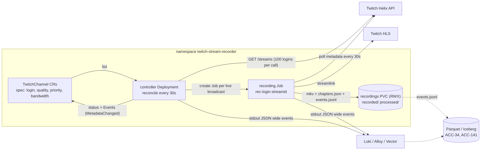

# Components



```yaml
components:
  - name: TwitchChannel CRD
    kind: api
    owns: desired state per channel (login, quality, priority, paused, container, bandwidth); observed state in status
    code: helm/crds/twitchchannels.recorder.civon.github.io.yaml
  - name: controller
    kind: deployment (1 replica, Recreate)
    owns: deciding when a channel needs a recording Job; status; Kubernetes Events; concurrency cap
    code: recorder/controller/
    talks_to: [Kubernetes API, Twitch Helix]
  - name: recording Job
    kind: batch/v1 Job, one per live broadcast
    owns: capture, metadata timeline, finalize (remux + chapters), stream.* and recording.* wide events
    code: recorder/cli.py (record), recorder/session.py, recorder/metadata.py, recorder/events.py, recorder/chapters.py
    talks_to: [Twitch Helix, Twitch HLS, recordings volume]
  - name: Job template
    kind: ConfigMap rendered by Helm
    owns: the pod shape (image, env, volumes, resources, scheduling, failure policy)
    code: helm/templates/_helpers.tpl (jobTemplate), helm/templates/controller.yaml
  - name: recordings volume
    kind: PersistentVolumeClaim (ReadWriteMany preferred)
    owns: recorded/<login>/ (in flight), processed/<login>/ (final + sidecars)
  - name: legacy watcher
    kind: Deployment per channel (operator.enabled=false)
    owns: same as recording Job, but loops forever for one channel
    code: twitch-recorder.py -> recorder/cli.py (watch)
```

## Responsibilities in one sentence each
- **The chart** decides what a recording pod looks like.
- **The controller** decides when a recording pod should exist.
- **The recording Job** decides what happened during the recording and says so in events.

## Life of a broadcast
1. Tick N: Helix says `kana` is live, stream `40000000001`, category `Music`.
   No Job `rec-kana-40000000001` exists and a slot is free, so the controller
   creates it, sets `status.phase=Recording`, and records
   `RecordingScheduled` and `StreamOnline` Events.
2. The Job checks the broadcast is still the same one, emits
   `recording.started`, and starts streamlink into
   `recorded/kana/<name>.ts`.
3. 47 minutes later the streamer switches to VALORANT. Within one poll
   interval the Job emits `stream.metadata_changed` with
   `recording.offset_ms=2820000`; the controller's next tick updates
   `status.categoryName` and records a `MetadataChanged` Event.
4. The broadcast ends; streamlink exits; the Job remuxes to
   `processed/kana/<name>.mkv` with chapters `Music` and `VALORANT`, writes
   `chapters.json`, moves `events.jsonl`, emits `recording.session`, and
   exits 0. The controller sets `phase=Offline`.
