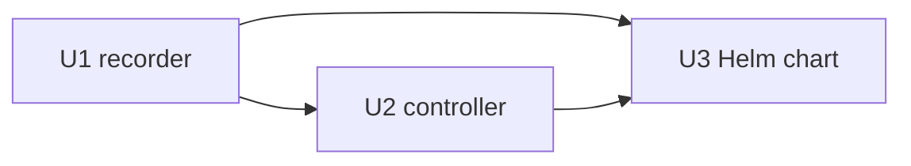

# Units of work

| Unit | Scope | Code | Requirements |
|---|---|---|---|
| U1 recorder (data plane) | Helix client, metadata snapshots and diff, wide events and sinks, chapters, recording session, `record` and `watch` commands, legacy entry point | `recorder/{twitch,metadata,events,chapters,session,cli}.py`, `twitch-recorder.py`, `config.py`, `Dockerfile` | FR-3..7, FR-10, NFR-2, 6, 7, 8 |
| U2 controller (control plane) | API client, Job builder, scheduler, reconcile loop, entry point | `recorder/controller/` | FR-2, 8, 9, NFR-1, 3 |
| U3 Helm chart | CRD, controller Deployment and RBAC, Job template, TwitchChannel rendering, shared PVC, existingSecret, legacy gating | `helm/` | FR-1, 8, 10, NFR-4, 5 |

## Dependencies

- U2 imports `recorder.metadata` and `recorder.events` from U1 and launches U1's `record` command in Jobs.
- U3 renders the Job template whose command and arguments U1 defines, and the CRD U2 reads.

## Traceability
| Requirement | Tests |
|---|---|
| FR-2 | `tests/test_controller.py::test_reconciler_schedules_job_and_reports_category_change`, `test_job_name_is_dns_safe_and_bounded`, k3s run |
| FR-3 | `tests/test_cli.py::test_record_continues_in_a_new_part_while_broadcast_is_live`, `test_record_asks_job_to_retry_when_pod_stops_mid_stream`, `test_record_gives_up_on_repeated_empty_captures`, record smoke test |
| FR-4 | `tests/test_metadata.py`, `tests/test_session.py::test_category_change_becomes_event_chapter_and_session_summary` |
| FR-5 | `tests/test_events.py`, session test (events file content) |
| FR-6 | `tests/test_chapters.py`, `tests/test_session.py::test_leftover_rebuilds_chapters_from_events_sidecar`, real ffmpeg remux |
| FR-7 | `tests/test_session.py::test_failed_remux_keeps_raw_file` |
| FR-8 | `tests/test_controller.py::test_plan_respects_priority_cap_pause_and_existing_jobs`, `test_reconciler_defers_over_cap`, `test_build_job_stamps_identity_without_mutating_template` |
| FR-9 | reconciler tests, k3s run (`kubectl get tch`, Events) |
| FR-10 | `tests/test_cli.py::test_legacy_flags_still_parse`, legacy render diff |
